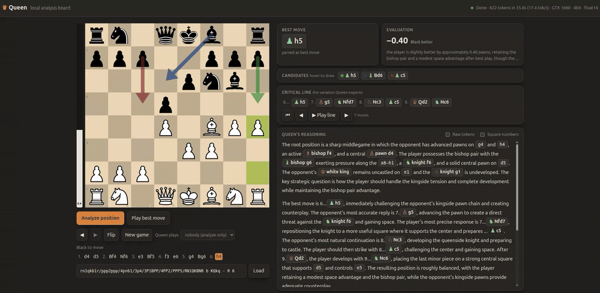

# Queen local analysis board

Run [Queen](https://huggingface.co/collections/princeton-nlp/queen-chess-models)
(`princeton-nlp/queen_pawn-8`) on your own machine. You get an interactive board
that streams the model's analysis as it writes it: the best move, an evaluation,
candidate moves, the critical line and its full reasoning.



The official runner needs vLLM, BF16 and about 9 GB of VRAM.
[`queen_engine.py`](queen_engine.py) reproduces the same pipeline on plain
Hugging Face transformers. The 3B decoder is quantized to 4-bit by default, so
it fits on a 6 GB card. It also runs on CPU.

## Setup

```bash
python3 -m venv .venv
.venv/bin/python -m pip install -r requirements.txt
```

Download the model into `models/queen_pawn-8/`:

```bash
.venv/bin/hf download princeton-nlp/queen_pawn-8 --local-dir models/queen_pawn-8
```

Optional: clone the research code and the project page next to it. Neither is
needed to run the board.

```bash
git clone https://github.com/queen-project/queen.git queen
git clone https://github.com/queen-project/queen-project.github.io.git site
```

## Usage

### Board UI

```bash
.venv/bin/python server.py
```

Then open http://127.0.0.1:8765. Options: `--host`, `--port`,
`--device cuda|cpu`, and `--quant 4bit|none` (`none` runs fp16 and needs
about 9 GB of VRAM).

### Command line

```bash
.venv/bin/python run_queen.py --fen 'rnbqkbnr/pppppppp/8/8/8/8/PPPPPPPP/RNBQKBNR w KQkq - 0 1'
```

The model's text streams to stderr, and a JSON result prints to stdout. Run
`run_queen.py --help` for all options.

## Layout

- `queen_engine.py` runs inference on transformers, with no vLLM.
- `server.py` serves the board UI and streams analyses as NDJSON.
- `run_queen.py` analyzes a single position from the command line.
- `ui/` holds the board front end.
- `queen/` and `site/` (not tracked here) hold the upstream research code and
  the project page.
